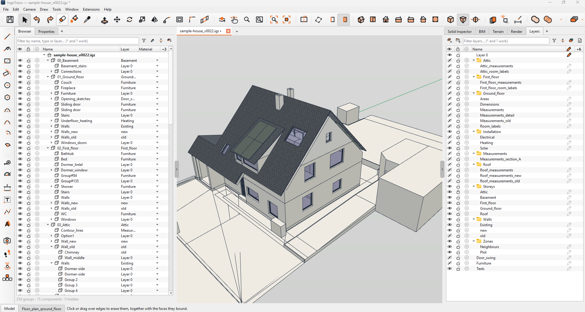
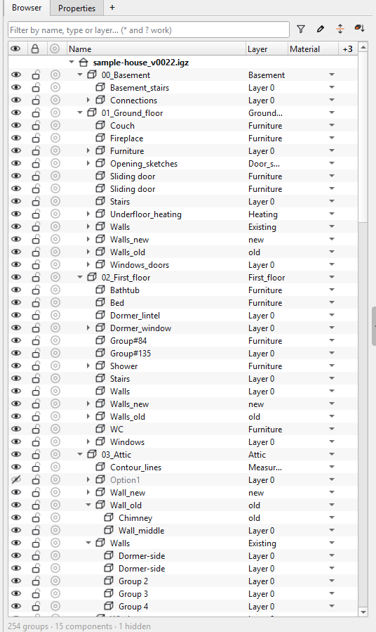
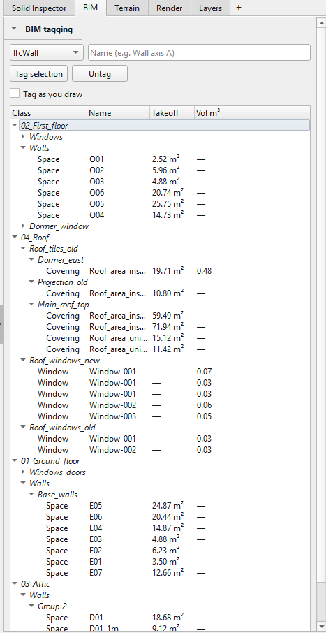
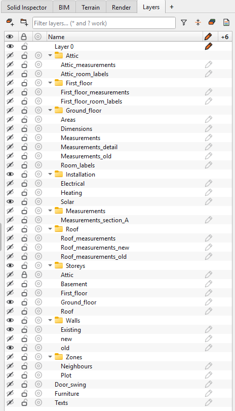
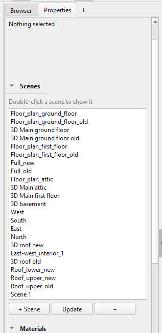
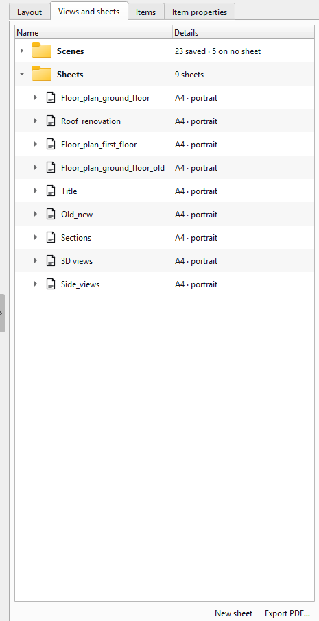

# Single-Family House – Gut Renovation with BIM System

A real-world example model for [IngeTrazo](https://github.com/BastelBaus/ingetrazo-docs):
a 1958 single-family house with basement, ground floor, first floor and attic,
modelled as **existing state and planned gut renovation**.

It could be used as blue print how to model such a project in IngeTrazo. See [discussion](https://github.com/ingelibre/ingetrazo/discussions/1049)

** It is work in progress **
- walls removed / new walls, openings --> done over layers
- dimensions --> done, over layer (to be improved in tooling)
- multiple sheets as documentation --> ongoing
- BIM documentation --> ongoing
- furniture --> partally started
- heating circuits --> not done
- electrical not done

## Examples how it is modelled

Workplace

Model browser

BIM structure

Layers

Views

Sheets

## Licence

© 2026 BastelBaus. The model and documentation are licensed under
[Creative Commons Attribution 4.0 International (CC BY 4.0)](https://creativecommons.org/licenses/by/4.0/) –
see [LICENSE](LICENSE). You may share and adapt them, also commercially, as long as you
credit "BastelBaus – IngeTrazo sample house" and link to this repository.

Embedded textures (`textures/` inside the `.igz`) are not covered by this licence and
remain the property of their respective owners.
